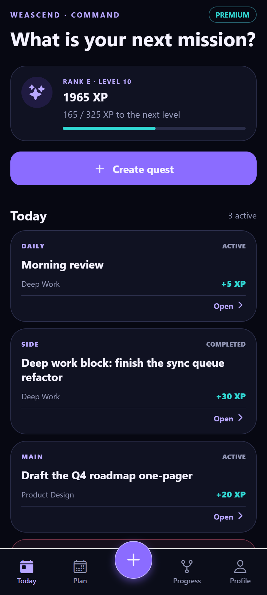
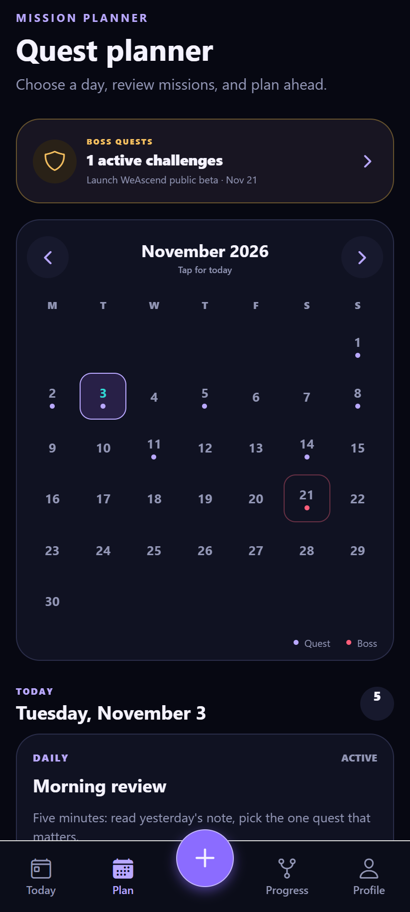
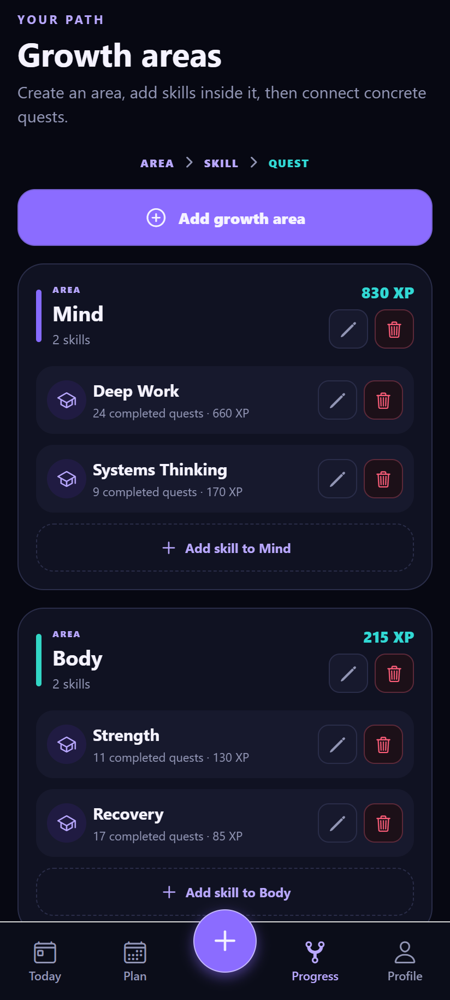

<p align="center">
  
</p>

<h1 align="center">WeAscend</h1>

<p align="center">
  <em>Turn personal goals into a quest log. Clear a quest, earn XP once, watch the rank grow.</em>
</p>

<p align="center">
  <a href="https://github.com/stefanovic000/WeAscend/actions/workflows/ci.yml"></a>
  
  
  
  
  
</p>

---

WeAscend is a personal progress system built around one idea: **effort should be recorded as a
transaction, not as a number you can edit.** You plan a quest, define a measurable success condition,
and when you clear it the system writes exactly one XP transaction into an append-only ledger. That
ledger is the only source of truth for your level, rank, attributes and skills — which is why undo,
history and statistics are always exact.

It runs as an installable PWA in production, behind a REST API on the edge, with a native Expo client
in progress against the same contract.

> **Status:** closed beta at [weascend.wesystemlabs.com](https://weascend.wesystemlabs.com).
> Billing is not enabled; AI features are optional and degrade gracefully without an API key.

**Design highlights**

- **XP is derived, never stored** — levels and ranks are computed from the ledger, so a quest cannot
  award XP twice and undo reverses a transaction instead of deleting history.
- **The server re-validates everything** — the UID comes from a verified Firebase token, and every
  state write is structurally re-checked, limited and quota-enforced before it lands.
- **Offline is read-only by design** — the last confirmed snapshot is cached per account for browsing;
  no mutation is queued or replayed behind your back.
- **AI suggests, rules decide** — model output is validated against hard XP allow-lists server-side,
  so it can never invent a reward the category does not permit.

## Screenshots

<p align="center">
  
  <br>
  <em>Command dashboard: rank, global XP and today's single priority quest</em>
</p>

| Quest planner | Attributes & skills |
| --- | --- |
|  |  |
| *Calendar, routines and reusable templates* | *XP rolls up per attribute and skill* |

| Boss quests | History & statistics |
| --- | --- |
|  |  |
| *Preparation steps, attempts and a clear condition* | *Every XP has a source, a time and a state* |

### Native app (Expo)

<table>
<tr>
<td width="24%" align="center"><br><em>Today</em></td>
<td width="24%" align="center"><br><em>Plan</em></td>
<td width="24%" align="center"><br><em>Progress</em></td>
<td width="28%" valign="middle">
<strong>React Native client</strong><br><br>
Same API and shared domain types, native navigation and gestures. Today, planner, growth areas,
bosses and history are wired; Google sign-in and AI planning are next.
</td>
</tr>
</table>

## Stack

| | |
| --- | --- |
| **Web** | Next.js 16 App Router · React 19 · Vite (`vinext`) · TypeScript · 85 KB hand-written CSS |
| **Edge** | Cloudflare Workers · Firebase ID-token verification (`jose`) · MongoDB driver |
| **Native** | Expo SDK 57 · React Native 0.86 · expo-router (in progress) |
| **Services** | MongoDB Atlas · Firebase Auth · DeepSeek (JSON mode) · Resend |
| **Tooling** | `node:test` · ESLint · Playwright screenshot capture |

## Documentation

| Document | What is inside |
| --- | --- |
| [Architecture](docs/architecture.md) | Diagram, layers, state model, the two write paths, sync and security |
| [XP system](docs/xp-system.md) | Categories, level formula, ranks, quest lifecycle, bosses, AI guardrails |
| [Features](docs/features.md) | What each screen does, area by area |
| [Development](docs/development.md) | Environment variables, commands, deployment, troubleshooting |
| [Operations (SR)](docs/operations.sr.md) | Original Serbian operational notes: Firebase, Atlas, Resend, Play Store |

Repository map: `apps/web` (PWA + API) · `apps/mobile` (Expo) · `packages/shared` (shared types) ·
`android-twa` (Play wrapper) · `docs` (documentation and screenshot tooling) · `scripts` (checks).

## Quick start

Requires **Node.js 22.13+**.

```bash
npm run install:all
cp apps/web/.env.example apps/web/.env.local
npm run dev            # http://localhost:3000
```

Without Firebase configuration the app starts in local development mode with a test identity and an
IndexedDB-only cache; without MongoDB it stays read-only. Both paths are development-only.

```bash
npm test               # 46 domain and server tests
npm run typecheck      # tsc --noEmit, zero errors
npm run lint           # ESLint
npm run build          # production build
npm run android:check  # PWA ↔ TWA manifest consistency
```

## Quality

- **46 unit tests** over the XP formula, rank thresholds, duplicate awards, undo, templates, boss
  attempts, cloud-state validation, content limits, plan quotas, auth boundaries and email builders.
- **CI** runs tests, lint, strict typecheck and a production build on every push, plus a typecheck of
  the native client and the Android manifest check.
- **The API** enforces authentication, payload caps, content limits and per-plan storage quotas;
  secrets never reach the browser bundle.
- **Screenshots are reproducible** — `docs/demo` mocks the API in a real browser for both clients and
  drives a deterministic ledger that must pass `isValidCloudState` before capture.

## Roadmap

- [ ] Route every mutation through the command endpoints and remove the duplicated client-side transitions.
- [ ] Split the 2k-line web shell into per-view modules and a tested sync hook.
- [ ] Merge conflicts instead of replacing a device's pending edits with the server snapshot.
- [ ] Finish the native client: Google sign-in, bosses, AI planning.
- [ ] End-to-end tests for sign-in, quest lifecycle and offline recovery.

## License

[MIT](LICENSE) © 2026 Uroš Stefanović
