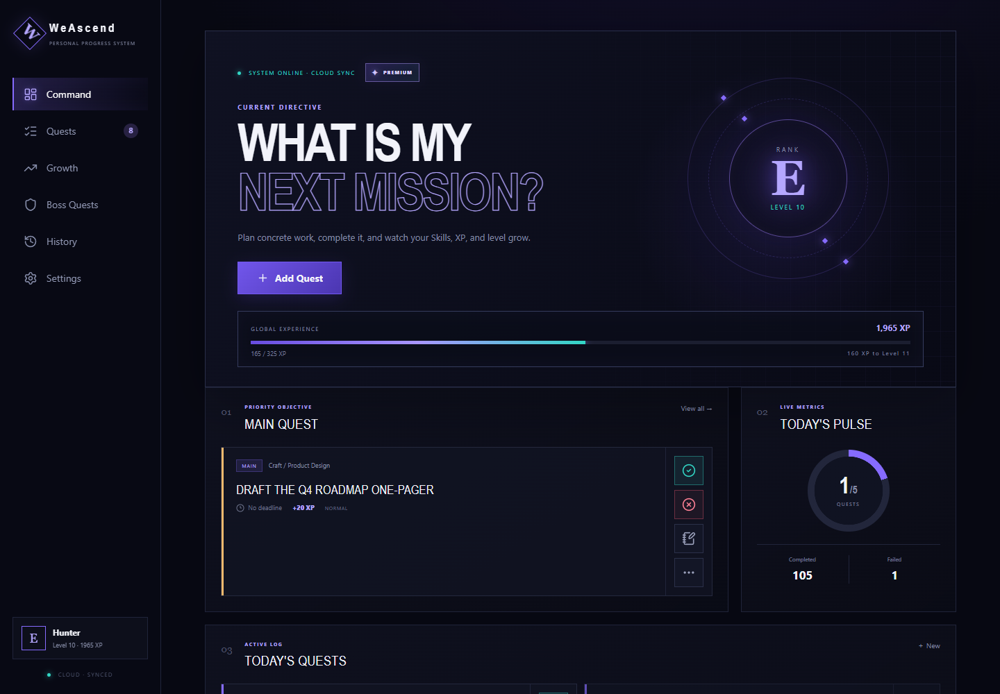
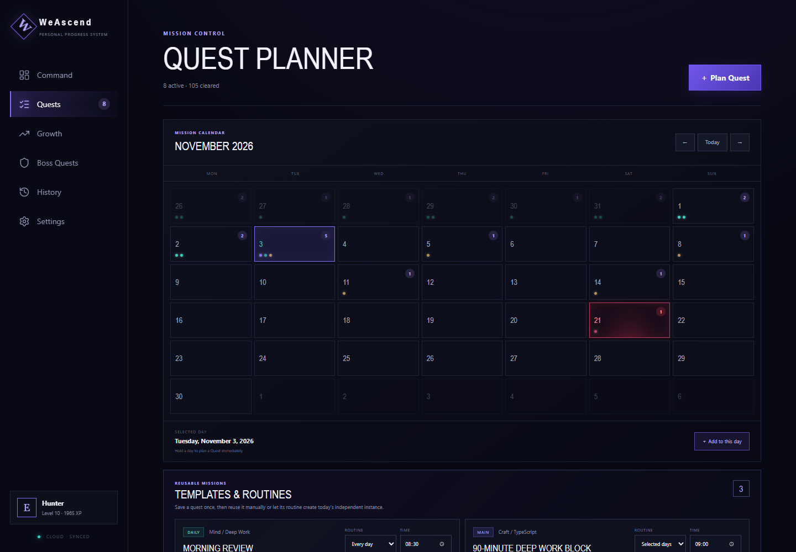
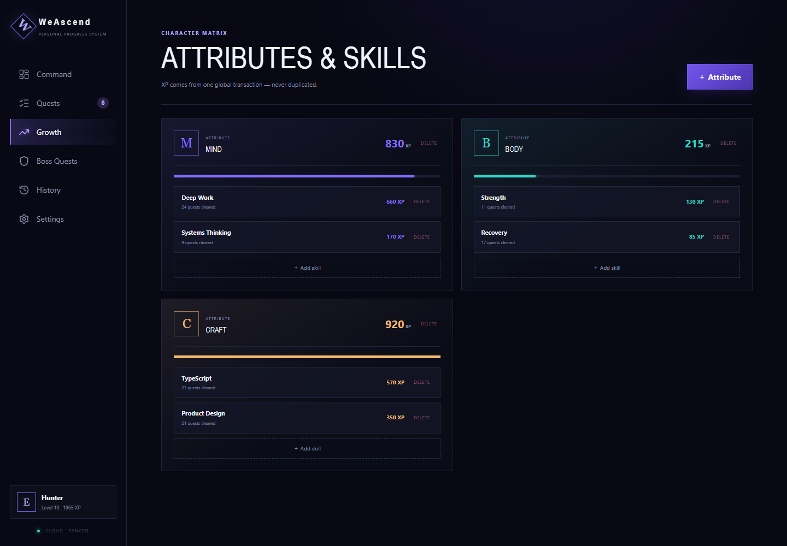
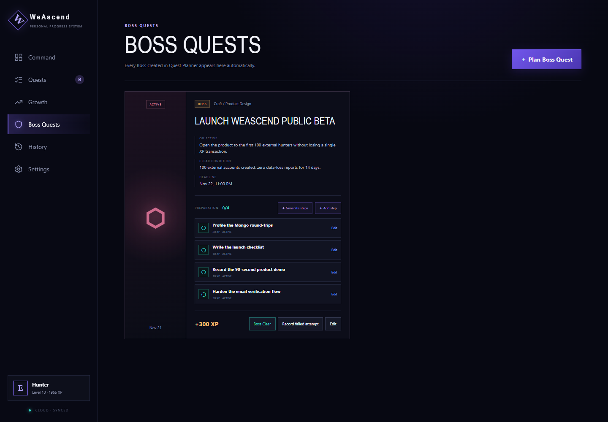
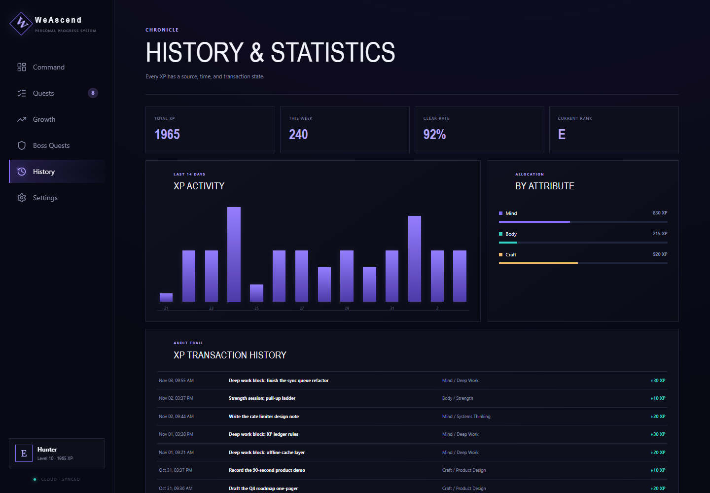
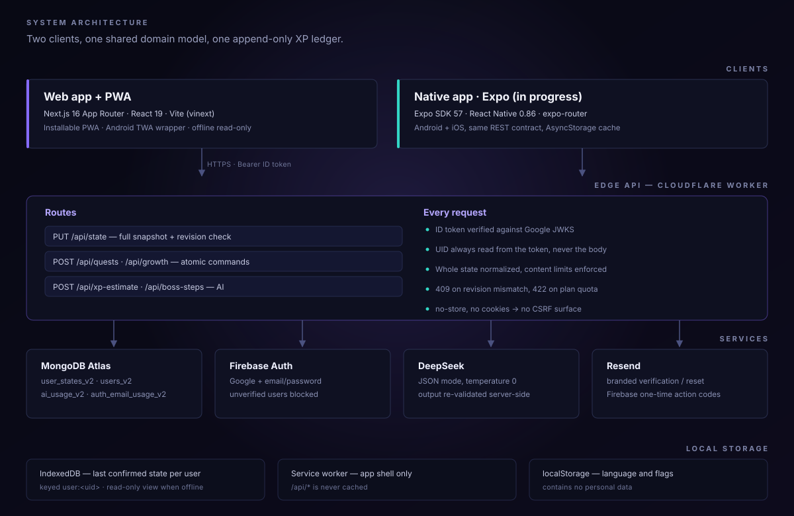

<p align="center">
  
</p>

<h1 align="center">WeAscend</h1>

<p align="center">
  <em>Turn personal goals into a quest log. Clear a quest, earn XP once, watch the rank grow.</em>
</p>

<p align="center">
  <a href="https://github.com/stefanovic000/weascend/actions/workflows/ci.yml"></a>
  
  
  
  
  
  
</p>

---

**WeAscend** is a personal progress system built around one idea: effort should be recorded as a
transaction, not as a number you can edit. You plan a quest, define a measurable success condition,
and when you clear it the system writes **one** XP transaction into an append-only ledger. That
ledger is the only source of truth for your level, rank, attributes and skills — which is why undo,
history and statistics are always exact.

It is a real product: an installable PWA in production, a REST API on the edge, an Expo client in
progress, and a domain model that both clients share.

> **Status:** closed beta at [weascend.wesystemlabs.com](https://weascend.wesystemlabs.com). Billing is not enabled;
> AI features are optional and degrade gracefully when no API key is configured.

<p align="center">
  
</p>

## Why this project is not just a CRUD app

- **XP is derived, never stored.** Levels and ranks are computed from the transaction ledger, so a
  completed quest can never award XP twice and undo reverses a transaction instead of deleting history.
- **The server re-validates everything.** A Firebase ID token is verified against Google's JWKS, the
  UID is always taken from the token, and the full state is structurally re-checked before it is written.
- **Offline is read-only by design.** IndexedDB keeps the last confirmed snapshot per account for
  browsing; every mutation is blocked while the cloud is unreachable.
- **Concurrency is explicit.** Each write carries a revision; a stale device gets `409` and the server
  snapshot instead of silently overwriting newer work.
- **AI only suggests.** DeepSeek returns a JSON XP estimate which is validated against hard XP
  allow-lists on the server — the model can never invent a reward that the rules do not allow.

## Screenshots

| Quest planner | Attributes & skills |
| --- | --- |
|  |  |
| *Calendar, routines and reusable templates* | *XP rolls up per attribute and skill* |

| Boss quests | History & statistics |
| --- | --- |
|  |  |
| *Preparation steps, attempts and a clear condition* | *Every XP has a source, a time and a state* |

| Quest editor | Settings & plan usage |
| --- | --- |
|  |  |
| *Rules-based XP with an optional AI estimate* | *Language, account, tutorial and plan limits* |

<table>
<tr>
<td width="34%" align="center"><br><em>Same PWA, mobile layout</em></td>
<td width="34%" align="center"><br><em>Calendar and routines on a phone</em></td>
<td width="32%" valign="middle">
<strong>One codebase, two form factors.</strong><br><br>
The web client is a responsive PWA with an installable shell, offline read-only mode and a bottom
navigation on phones. A Google Play TWA wrapper reuses the same build, and a native Expo client is
being developed against the same REST contract.
</td>
</tr>
</table>

## Architecture

<p align="center">
  
</p>

| Layer | Choice | Why |
| --- | --- | --- |
| Web client | Next.js 16 App Router + React 19, built with Vite (`vinext`) | Server components for static pages, one deployable for UI + API |
| Runtime | Cloudflare Workers | Global edge, no server to keep alive |
| Data | MongoDB Atlas | One document per account: the whole state plus a revision |
| Auth | Firebase Auth + `jose` JWKS verification | Google and email/password without running an auth server |
| AI | DeepSeek chat completions, JSON mode | XP estimates and boss-step drafts, always re-validated |
| Mail | Resend + Firebase Admin service account | Branded verification and reset emails with one-time codes |
| Native | Expo SDK 57 / React Native 0.86 | Android and iOS against the same API |

### The domain model

`AppState` is a small, deliberately boring document:

```ts
type AppState = {
  version: 1;
  attributes: Attribute[];      // "Mind", "Body", "Craft"
  skills: Skill[];              // nested under an attribute
  quests: Quest[];              // active / completed / failed / archived
  transactions: XpTransaction[]; // append-only, reversible via reversedAt
  bossAttempts?: BossAttempt[];
  questTemplates?: QuestTemplate[];
  settings: Settings;           // XP formula inputs, ranks, UI preferences
  levelEvents: { type: "level" | "rank"; value: string; createdAt: string }[];
};
```

`apps/web/app/domain.ts` is a pure reducer module — no React, no IO, no clock — so the same rules run
in the browser (optimistic UI) and on the server (authoritative write), and the entire rule set is
covered by unit tests.

### Two write paths, on purpose

| Path | Used for | Guarantees |
| --- | --- | --- |
| `PUT /api/state` | Full snapshot sync, debounced after local edits | Structural validation, content limits, plan quota, revision check |
| `POST /api/quests` · `/api/growth` | Atomic commands (create, complete, archive, boss attempt) | The server re-applies the transition to its own copy, then compares revisions |

The snapshot path keeps the client simple and lets it work optimistically; the command path gives
strict per-action semantics. Migrating the remaining snapshot mutations onto commands is on the
roadmap — see below.

## How XP works

XP is chosen by category, never by difficulty. Difficulty and quest type never multiply a reward.

| Category | What it rewards | Scale |
| --- | --- | --- |
| `growth` | Focused work | 0 / 5 / 10 / 20 / 30 / 40 by minutes, +0 / 5 / 10 for a concrete output, capped at 50 |
| `maintenance` | Routine upkeep | 0 / 5 / 10 |
| `result` | A completed deliverable | 0 / 10 / 20 / 30 |
| `boss` | Real tests and milestones | 0 / 75 / 100 / 150 / 200 / 300 / 400 |

- A level costs `100 + 25 × (level − 1)` XP; ranks sit at levels 1 / 20 / 40 / 60 / 80 / 100 (E → S).
- One quest instance can award XP **once**; undo marks the transaction reversed.
- Deleting a quest keeps its legitimately earned transaction as an anonymous historical record, so the
  ledger always adds up.
- Skills and attributes with history are soft-deleted rather than removed.

## Features

**Quests** — calendar planner, long-press a day to plan, six quest types, measurable completion
conditions, deadlines, notes, archive/restore, six filters, JSON export and import.

**Progression** — append-only XP ledger, level and rank-up ceremonies, per-attribute and per-skill
rollups, 14-day activity chart, clear rate, allocation breakdown.

**Bosses** — a boss is a quest with a gate, a clear condition and preparation steps that earn their
own XP; attempts are recorded with results; an optional AI planner drafts up to 12 editable steps.

**Templates** — save a quest as a routine with a daily / weekly / interval schedule; instances are
materialised per day and stay independent, so editing a template never rewrites history.

**Accounts** — Google and email/password sign-in, email verification, branded verification and reset
emails, account deletion from the app and from a public `/delete-account` URL, per-account local cache.

**AI (optional)** — XP estimate, a reasoned appeal when you disagree, and boss-step drafts. Every
response is schema-checked; prompts treat quest text as data, never as instructions.

**Polish** — 13-step guided tour with live highlighting, English and Serbian, haptics, reduced-motion
support, PWA install, read-only offline mode.

## Repository layout

```text
weascend/
├── apps/web/            Next.js PWA + REST API (Cloudflare Worker)
│   ├── app/             routes, domain model, UI, i18n
│   ├── server/          auth, Mongo, AI protection, email
│   ├── tests/           46 node:test cases over the domain and server rules
│   └── public/          manifest, service worker, icons
├── apps/mobile/         Expo / React Native client (in progress)
├── packages/shared/     Types and shared helpers for the native client
├── android-twa/         Bubblewrap wrapper for Google Play (legacy path)
├── docs/                architecture, screenshots, demo tooling
└── scripts/             Android consistency and asset-link checks
```

## Getting started

Requires **Node.js 22.13+**.

```bash
npm run install:all     # installs apps/web and apps/mobile
cp apps/web/.env.example apps/web/.env.local
npm run dev             # http://localhost:3000
```

Without Firebase configuration the app runs in local development mode with a test identity and an
IndexedDB-only cache; without MongoDB it stays read-only. Both paths are intentionally available in
development only.

```bash
npm test                # 46 domain and server tests
npm run lint            # ESLint
npm run typecheck       # tsc --noEmit
npm run build           # production build
npm run android:check   # PWA ↔ TWA configuration consistency
```

Environment variables, deployment notes and troubleshooting live in **[docs/development.md](docs/development.md)**.
The original Serbian operational notes are kept in **[docs/operations.sr.md](docs/operations.sr.md)**.

## Screenshots are reproducible

The images above are generated from a deterministic demo ledger against a fully mocked API — no
database, no Firebase project, no production traffic:

```bash
npm run dev                    # terminal 1, from the repository root
cd docs/demo && npm install    # terminal 2
npm run capture
```

The demo state is validated against the real `isValidCloudState` guard before capture, so the
screenshots cannot drift away from the schema the product accepts.

## Quality

- **46 unit tests** cover the XP formula, rank thresholds, duplicate awards, undo, templates, boss
  attempts, cloud-state validation, content limits, plan quotas, auth boundaries and email builders.
- **CI** runs tests, lint, strict TypeScript and a production build on every push, plus a typecheck
  of the native client.
- **Lint** is clean; Android TWA configuration is checked against the PWA manifest on every run.
- The API enforces authentication, payload limits, content limits and per-plan storage quotas; secrets
  never reach the browser bundle.

## Roadmap

- [ ] Route every mutation through the command endpoints and delete the duplicate client-side transitions.
- [ ] Split the 2k-line web shell into per-view modules and a tested sync hook.
- [ ] Merge conflicts instead of replacing a device's pending edits with the server snapshot.
- [ ] Finish the native client: Google sign-in, bosses, AI planning.
- [ ] End-to-end tests for sign-in, quest lifecycle and offline recovery.

## License

[MIT](LICENSE) © 2026 Uroš Stefanović
