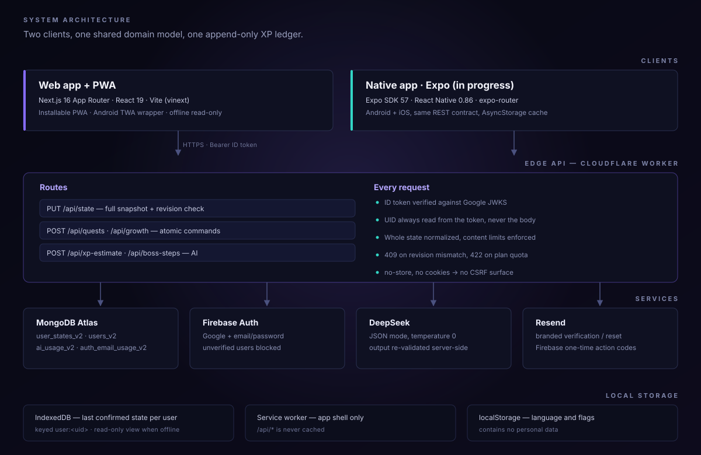

# Architecture

> How WeAscend is put together: two clients, one edge API, one ledger.
> Back to the [README](../README.md).

<p align="center">
  
</p>

## Layers

| Layer | Choice | Why |
| --- | --- | --- |
| Web client | Next.js 16 App Router + React 19, built with Vite (`vinext`) | Server components for static pages; one deployable serves UI and API |
| Runtime | Cloudflare Workers | Global edge, no server to keep alive, zero cold infrastructure |
| Data | MongoDB Atlas | One document per account: the whole state plus a revision |
| Auth | Firebase Auth + `jose` JWKS verification | Google and email/password without running an auth server |
| AI | DeepSeek chat completions, JSON mode | XP estimates and boss-step drafts, always re-validated |
| Mail | Resend + Firebase Admin service account | Branded verification and reset emails built on one-time Firebase codes |
| Native | Expo SDK 57 / React Native 0.86 | Android and iOS sharing the same REST contract and domain types |

## The state document

`AppState` is deliberately boring — one JSON document per user, no joins, no migrations framework:

```ts
type AppState = {
  version: 1;
  attributes: Attribute[];       // "Mind", "Body", "Craft"
  skills: Skill[];               // nested under an attribute
  quests: Quest[];               // active / completed / failed / archived
  transactions: XpTransaction[]; // append-only, reversed via reversedAt
  bossAttempts?: BossAttempt[];
  questTemplates?: QuestTemplate[];
  settings: Settings;            // XP formula inputs, ranks, UI preferences
  levelEvents: { type: "level" | "rank"; value: string; createdAt: string }[];
};
```

Every read and write passes through `normalizeCloudState`, which validates the shape and rejects
malformed documents instead of coercing them. Unknown fields are dropped, `null` is removed from
optional fields, and an active duplicate XP award for the same quest is a hard validation failure.

`apps/web/app/domain.ts` is a pure reducer module: no React, no IO, no clock (timestamps are injected).
The same rules therefore run in the browser for optimistic UI and on the server as the authority,
and the whole rule set is unit-testable.

## Two write paths

| Path | Used for | What it guarantees |
| --- | --- | --- |
| `PUT /api/state` | Snapshot sync, debounced 550 ms after local edits | Structural validation, content limits, plan quota, `revision` check |
| `POST /api/quests` · `POST /api/growth` | Atomic commands: create, update, complete, archive, boss attempt | The server re-applies the transition to its own copy, then compares revisions |

The snapshot path keeps the client simple and lets it edit optimistically without a round trip per
keystroke; the command path gives strict per-action semantics and a small payload. Moving the
remaining snapshot mutations onto commands is on the roadmap — it removes the duplicated transition
logic currently kept in the web shell.

## Sync, conflicts and offline

- Every write carries the `revision` the client last saw. A mismatch returns `409` with the server
  snapshot, so a stale device cannot silently overwrite newer work.
- The client stores the last **confirmed** snapshot in IndexedDB under `user:<uid>`; a failed write
  rolls back to that snapshot rather than keeping a half-applied local state.
- Offline is intentionally read-only: browsing, history and export work; every mutation is refused
  with an explanation. Nothing is queued and replayed later, which keeps the ledger unambiguous.
- Service worker caches the app shell only. `/api/*` is never cached.

## Security model

| Concern | Handling |
| --- | --- |
| Identity | Firebase ID token verified against Google's JWKS: RS256, audience, issuer, `auth_time`, stable `sub` |
| Authorisation | UID comes only from the verified token; the client never sends or chooses a user id |
| Email | Unverified accounts are limited to the verification endpoint; all other APIs require `email_verified` |
| Payloads | Hard size caps per route (4 KB–2 MB) and content limits per field, enforced server-side |
| Storage | Per-plan quest quota is checked on the server against the plan resolved from the database |
| AI | Quest text is marked as untrusted data in the prompt; responses are schema-checked against XP allow-lists |
| Secrets | Server-only variables; nothing sensitive is exposed as `VITE_*`/`NEXT_PUBLIC_*` |
| CSRF | No cookie-based auth, so there is no ambient credential to ride |
| Caching | Every API response is `Cache-Control: no-store, private` |

Deletion is two-phase in intent (the user row is marked `deleting` before data removal), and the app
plus a standalone `/delete-account` URL both drive the same endpoint.
