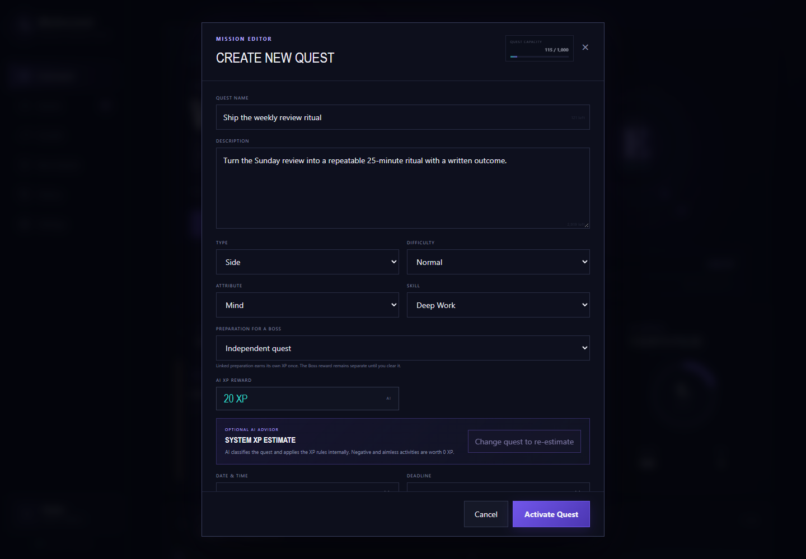
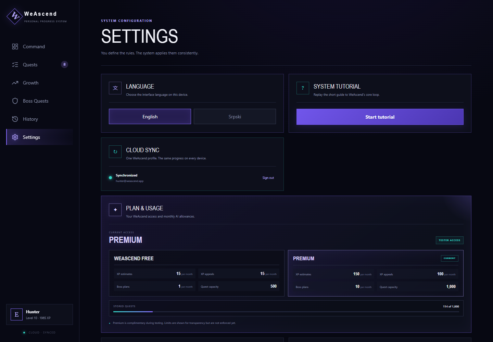
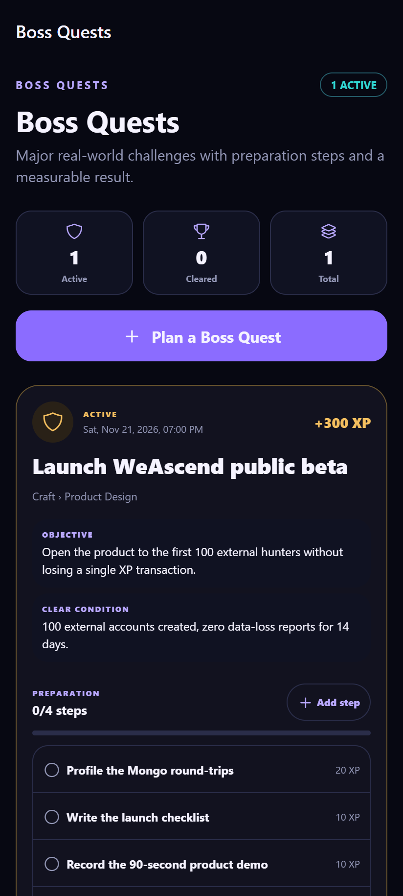
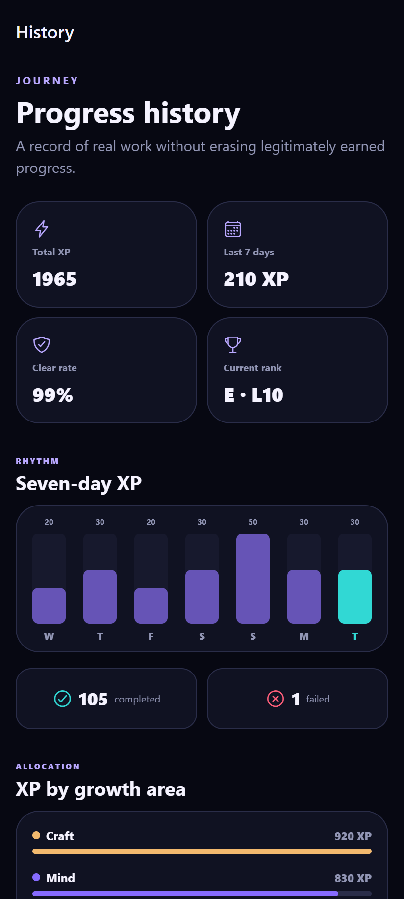
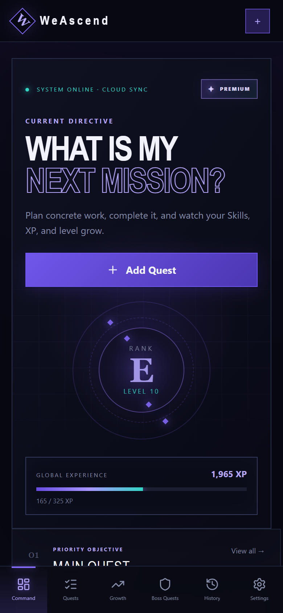
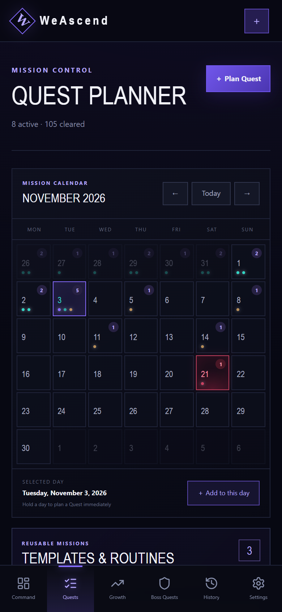

# Features

> What the product actually does, area by area.
> Back to the [README](../README.md).

## Command dashboard

The landing view answers three questions at once: where the level stands, what the one priority quest
is, and what today looks like.

- Rank orbit with level, global XP bar and "XP to next level".
- Priority objective: today's `Main` quest, falling back to any open main quest.
- Today's pulse: cleared vs planned quests for the day.
- Activity feed of the last four transactions.

## Quest planner

  
   
  <em>The editor: type, path, measurable condition, and a rules-based XP value with an optional AI estimate.</em>

- Month calendar with per-day quest counts and colour-coded type markers; long-press a day to plan a
  quest on that date.
- Day agenda and an "all dates" view, filtered by search, type, status and attribute.
- Six quest types (Main, Daily, Side, Mandatory, Correction, Boss), four difficulty labels, deadlines,
  completion conditions and failure consequences.
- Notes per quest, archive/restore, retry after failure, undo after completion.
- JSON export and import of the full state, per account.

## Quest templates

- Save any non-boss quest as a template and give it a schedule: none, daily, weekly (pick weekdays) or
  every N days from a start date.
- Templates materialise a normal, independent quest per day (`routine:<templateId>:<date>`), so
  editing a template never rewrites history and re-materialising is idempotent.
- "Add today" creates the instance manually when a routine should not wait for the schedule.

## Growth matrix

- Attributes (`Mind`, `Body`, `Craft`, …) with a colour, and skills nested under them.
- XP rolls up from the ledger per attribute and per skill, with cleared-quest counts.
- Deleting a skill or attribute with history soft-deletes it so the ledger stays exact.

## Boss quests

- A boss carries a gate/entry condition, a clear condition, a deadline and a reward.
- Preparation steps are linked quests that earn their own XP; progress is shown as `completed / total`.
- Attempts are recorded (failed or cleared) with a result note and an attempt number.
- Clearing archives the remaining preparation steps under a closed parent; undo reopens them.
- Optional AI planner drafts up to 12 editable steps with individual XP values.

## History and statistics

- Total XP, this week's XP, clear rate and current rank.
- 14-day activity chart and allocation breakdown by attribute.
- Full transaction audit trail: source quest, attribute/skill path, amount, time, reversal state.
- Level and rank-up events are kept in the same timeline.

## Accounts and privacy

  
   
  <em>Settings: language, cloud account, tutorial replay and plan usage.</em>

- Google sign-in and email/password, with verification enforced before any private API.
- Branded verification and password-reset emails through Resend, built on one-time Firebase action
  codes, with a `/email-action` page that handles verify, reset and recover-email.
- Account deletion from the app and from a public `/delete-account` URL (required by Google Play).
- Per-account local cache; a shared device never mixes two accounts.

## AI advisor (optional)

- XP estimate for a draft quest, with category, confidence and a one-line rationale.
- Appeal flow: ask for a different value with a written reason; the model accepts, adjusts or rejects.
- Boss-step planner that turns a goal into concrete, schedulable preparation quests.
- Strict output validation: an out-of-scale XP value or a missing rationale is treated as an invalid
  response, never applied.

## Native client (Expo)

  
  

- Expo Router tabs: Today, Plan, Progress and Profile, with a raised create action in the tab bar.
- Boss hub with preparation progress and attempts; history with a seven-day chart, clear rate and
  allocation by growth area.
- Uses the same REST contract and the shared types package; the cache is AsyncStorage instead of
  IndexedDB and the client never writes whole-state snapshots — every change is a command.
- Not finished: Google sign-in and the AI planner are still web-only.

## Interface and platform

  
  

- English and Serbian, switchable at runtime; the choice persists per device.
- 13-step guided tour with live element highlighting, replayable from Settings.
- Installable PWA: manifest, icons, standalone display, offline read-only mode.
- Responsive from 360 px phones to wide desktop, with bottom navigation on small screens.
- Accessibility basics: labelled controls, `aria-current` navigation, focus-visible outlines, reduced
  motion respected, haptics optional and off by default on desktop.
